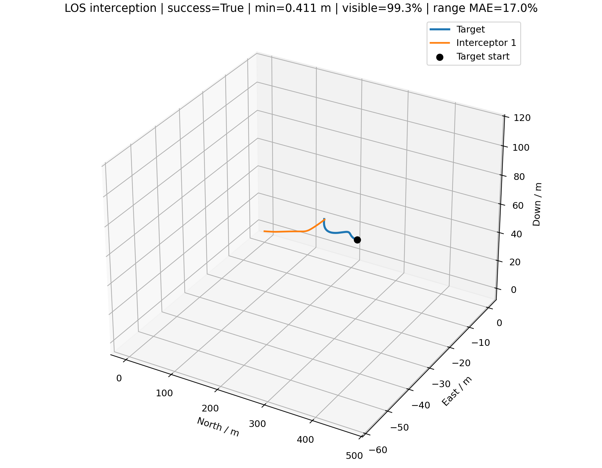
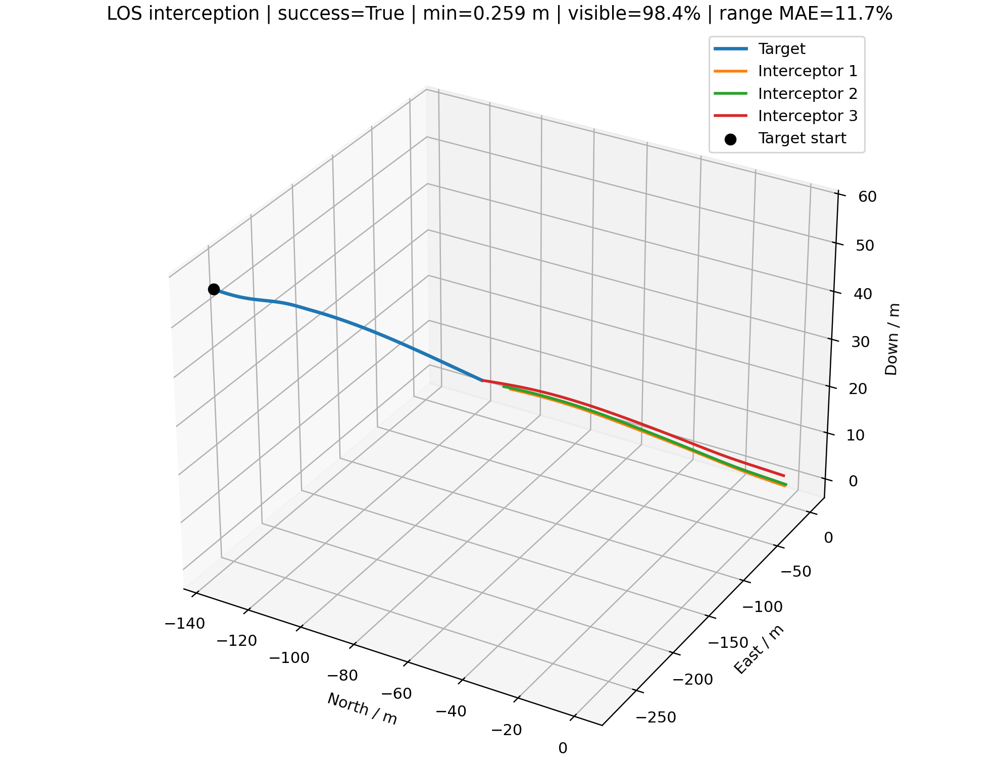

# 30 Hz精确延迟LOS角速度Stable LOS发布记录

## 发布范围

- 拦截机与靶机分别使用A型和C型动力学限制，命中阈值为0.6 m，末端jink关闭。
- 外环控制周期为0.1 s，相机帧率为30 Hz，控制器读取最近相机帧，对应1/30 s测量延迟。
- 相对位置保留0.5°方位/高度角误差、像素量化测距、±1 pixel误差、24°×16° FOV和1%丢检。
- LOS角速度由外部测量接口提供。当前仿真在延迟时刻使用精确LOS角速度，用于验证控制器在LOS率可准确读取条件下的性能上限。
- 执行链路包含1个控制周期指令延迟、0.2 s加速度响应和A型机5 m/s³ jerk限制。

## LOS角速度

延迟相对状态与LOS角速度按下式计算：

```text
tau = 1 / 30 s
r_delay = r(t) - tau * v_relative(t)
omega_LOS = cross(r_delay, v_relative) / |r_delay|^2
```

精确LOS率仅作为本版本明确设定的传感器输入。控制器接口同时保留`bearing_history`模式，可在没有外部LOS率时由连续方位观测估计。

## Stable LOS参数

| 参数 | 数值 |
|---|---:|
| 比例导航系数N | 4.0 |
| 追逐速度增益 | 0.04 |
| 最大提前时间 | 3.0 s |
| LOS率软阈值 | 0.002 rad/s |
| 期望速度低通时间常数 | 0.25 s |
| 期望速度变化率限制 | 4.0 m/s² |
| 加速度低通时间常数 | 0.12 s |

控制流程为：延迟观测与FOV门控、LOS率输入、短时提前方向、受限期望速度、追逐加速度与比例导航加速度合成、指令低通、控制延迟、执行响应、加速度与jerk限幅。

## 正式复测

单机和三机分别对六种轨迹测试100回合，每个场景合计600回合。三机场景为独立仓库原有的三架LOS拦截机构型；MAPPO仓库中的一架观测机加两架截获机构型具有不同的信息共享和评价链路，数据不直接混合统计。

### 单机

| 轨迹 | 命中率 | 振荡率 | 平均最近距离 |
|---|---:|---:|---:|
| 直线 | 100% | 0% | 0.068 m |
| 余弦 | 100% | 0% | 0.120 m |
| 圆弧 | 100% | 0% | 0.078 m |
| 随机推进 | 98% | 0% | 0.134 m |
| 多频S弯 | 49% | 1% | 0.947 m |
| B样条 | 92% | 3% | 0.238 m |
| **总体** | **89.83%** | **0.67%** | **0.264 m** |

### 三机

| 轨迹 | 命中率 | 振荡率 | 平均最近距离 |
|---|---:|---:|---:|
| 直线 | 100% | 1% | 0.076 m |
| 余弦 | 100% | 1% | 0.120 m |
| 圆弧 | 100% | 0% | 0.084 m |
| 随机推进 | 98% | 4% | 0.109 m |
| 多频S弯 | 55% | 1% | 0.796 m |
| B样条 | 94% | 6% | 0.169 m |
| **总体** | **91.17%** | **2.17%** | **0.226 m** |

振荡判定同时要求：回合持续时间不少于4 s、最大轴指令换向频率不低于0.4 Hz、速度跟踪误差在0.2–2.5 Hz频带的功率占比不低于0.25、速度误差峰峰值不低于0.8 m/s。

### MAPPO一观测机两截获机参考结果

同一Stable LOS参数在MAPPO仓库的一架A型观测机、两架A型截获机和共享航迹链路下得到以下结果。该环境使用实际执行加速度频谱判定振荡，与独立仓库的速度跟踪误差口径不同，因此两组振荡率不作等价比较。

| 轨迹 | 命中率 | 振荡率 |
|---|---:|---:|
| 直线 | 93% | 7% |
| 余弦 | 89% | 15% |
| 圆弧 | 94% | 12% |
| 随机推进 | 88% | 18% |
| 多频S弯 | 75% | 35% |
| B样条 | 41% | 67% |
| **总体** | **80.00%** | **25.67%** |

对应代码、4200回合全方法数据和三维轨迹位于[mappo_uav_project结果分支](https://github.com/SendohTan/mappo_uav_project/tree/accurate-los-30hz-dense-rl-20260824/docs/los_angular_rate_realistic_0p6/accurate_los_30hz_dense_rl_20260825)。

## 三维轨迹

单机与三机每种曲线均提供独立PNG和逐帧CSV：

- `trajectories/single/`
- `trajectories/multi/`

示例：





## 数据与复现

- `data/accurate_los_30hz_single.csv`：单机600回合逐回合数据。
- `data/accurate_los_30hz_single_summary.csv`：单机分轨迹汇总。
- `data/accurate_los_30hz_multi.csv`：三机600回合逐回合数据。
- `data/accurate_los_30hz_multi_summary.csv`：三机分轨迹汇总。

```powershell
python examples\stability_benchmark.py --scope single --profiles stable --episodes 100 --seed 2026082591
python examples\stability_benchmark.py --scope multi --profiles stable --episodes 100 --seed 2026082591
```

使用连续方位历史估计LOS率时执行：

```powershell
python -m los_uav_interception single --motion cosine --los-rate-source bearing_history
```
